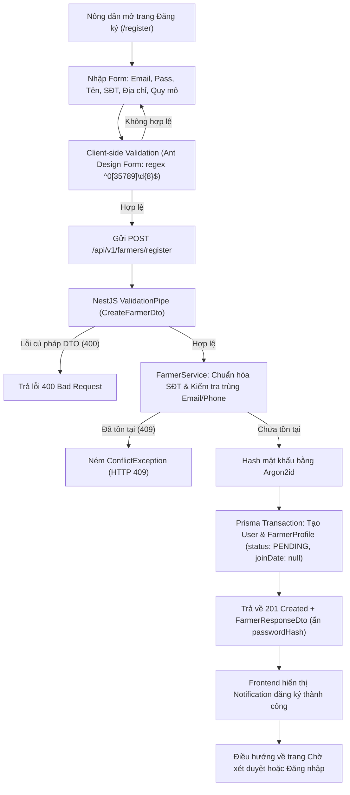
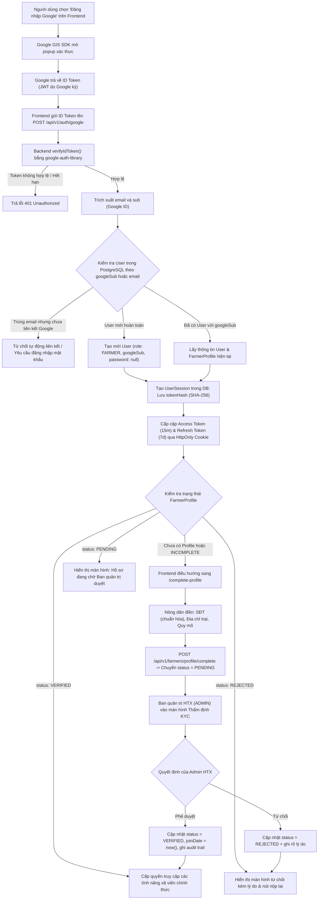

# Kế Hoạch Triển Khai Chi Tiết Epic 2 (EP02 Implementation Plan)
## Module: Quản Lý Định Danh & Hồ Sơ Nông Hộ (User & Farm Management)

> **Tài liệu tham chiếu:**
> - SRS: `docs/specs/SRS_Chuyen_Doi_So_HTX_Chan_Nuoi.docx` (và bản trích xuất `docs/specs/SRS_extracted.md`)
> - WBS: `docs/specs/WBS_ Chuyển đổi số HTX Chăn nuôi (Agri-ERP).docx` (và bản trích xuất `docs/specs/WBS_extracted.md`)
> - Quy chuẩn dự án: `AGENTS.md`

---

## 1. Phân Tích Phạm Vi & Đối Chiếu Yêu Cầu Cốt Lõi

### 1.1. Phụ thuộc Tiên quyết vào Epic 1 (Infrastructure & Database Setup)
Theo WBS, **Epic 2 có dependency trực tiếp vào Epic 1**:
- **Hạ tầng CSDL (Task WBS 1.1.1):** Cần hệ thống container Docker cách ly hoàn toàn (`agri_erp_postgres` chạy CSDL `agri_erp_db`, cổng ngoài độc lập `5433:5432`).
- **Lược đồ CSDL cốt lõi (Bảng Farmers):** WBS Epic 1 định nghĩa bảng `Farmers` gồm các trường:
  - `farmer_id` (Primary Key / UUID hoặc CUID)
  - `name` (Họ và tên chủ hộ)
  - `farm_location` (Địa chỉ / Tọa độ cơ sở chăn nuôi)
  - `capacity` (Quy mô chuồng trại / Sức chứa tối đa)
  - `join_date` (Ngày chính thức gia nhập HTX)
- **Tác động đến Epic 2:** Epic 2 phụ thuộc vào việc cấu hình cơ sở hạ tầng, lược đồ CSDL và kết nối Prisma Client đã sẵn sàng kết nối an toàn vào PostgreSQL trước khi thực hiện lưu dữ liệu tại Task `EP-02.3`.

### 1.2. Yêu cầu SRS Liên quan Trực tiếp đến Epic 2
- **Mục tiêu chức năng (SRS Mục 3, Khối 1):** "Đăng ký, định danh (KYC) hộ chăn nuôi, phân bổ quy mô chuồng trại, thiết lập tài khoản thú y/quản lý" (Độ ưu tiên: High).
- **Yêu cầu Phi chức năng - Bảo mật (SRS Mục 4):**
  - "Bảo mật API bằng JWT (JSON Web Tokens) và OAuth 2.0."
  - "Phân quyền Role-Based Access Control (RBAC) nghiêm ngặt."
  - Phản hồi API dưới 2000ms.
- **Ranh giới CSDL:** PostgreSQL được chỉ định lưu trữ dữ liệu ACID cho định danh, hồ sơ và giao dịch cốt lõi. MongoDB và Redis chưa có nghiệp vụ trong Epic 2 (chỉ dùng cho Epic 3, 5, 6).

---

## 2. Phân Định Rạch Ròi: Phạm Vi WBS Gốc vs Chức Năng Mở Rộng MVP

Nhằm bảo đảm tính toàn vẹn của WBS chính thức và không làm biến dạng phạm vi ban đầu, kế hoạch phân định rõ 2 phần:

### 2.1. Phạm vi Bắt buộc theo WBS Gốc (6 Task EP-02.1 đến EP-02.6)
Tập trung trọn vẹn vào **Use Case 2.1.1: Đăng ký và định danh (KYC) hộ chăn nuôi**:
1. `EP-02.1`: Tạo DTO cho Farmer Registration request/response (`create-farmer.dto.ts`, `farmer-response.dto.ts`).
2. `EP-02.2`: Cấu hình Controller tạo endpoint `POST /api/v1/farmers/register` (`farmer.controller.ts`).
3. `EP-02.3`: Viết Service logic mã hóa mật khẩu và lưu thông tin Farmer vào PostgreSQL (`farmer.service.ts`).
4. `EP-02.4`: Tạo React UI Component Form đăng ký tài khoản (`RegistrationForm.tsx`).
5. `EP-02.5`: Viết frontend API service gọi `POST /api/v1/farmers/register` (`farmerService.ts`).
6. `EP-02.6`: Xử lý form validation và hiển thị thông báo thành công/thất bại (`RegisterPage.tsx`).

### 2.2. Phạm vi Mở rộng cho Bản MVP (Extended Scope - Theo Yêu Cầu User)
Các chức năng này được bổ sung để hoàn thiện trải nghiệm người dùng thực tế và cơ chế xác thực cấp doanh nghiệp:
1. **Đăng nhập truyền thống (Local Login):** `POST /api/v1/auth/login` (xác thực email/mật khẩu với Argon2id).
2. **Đăng nhập Google (Google Sign-In via GIS):** Tích hợp Google Identity Services trên web và backend verify ID token bằng `google-auth-library` (`POST /api/v1/auth/google`).
3. **Quản lý Phiên & Token Nâng cao:** Cặp Access Token (15 phút) và Refresh Token (7 ngày) lưu trong HttpOnly Cookie, cơ chế xoay vòng token (Token Rotation), thu hồi phiên (Revocation / Logout) và phòng chống CSRF đa lớp.
4. **Onboarding Hồ sơ Nông hộ sau Đăng nhập Google:** Luồng tự động điều hướng người dùng Google chưa có cơ sở chăn nuôi sang trang hoàn thiện hồ sơ (`/complete-profile`).
5. **Vòng đời KYC & Verification Gate Hạt nhân:** Quản lý trạng thái hồ sơ nông hộ và kiểm soát phân quyền chi tiết theo từng endpoint nghiệp vụ cụ thể.

---

## 3. Ma Trận Chi Tiết: Task -> File -> Tiêu Chí Nghiệm Thu -> Cách Kiểm Thử

| Mã Task | Tên Task Chính Thức (WBS) | Đường Dẫn File Dự Kiến | Tiêu Chí Nghiệm Thu Kỹ Thuật (Acceptance Criteria) | Phương Pháp & Lệnh Kiểm Thử (Testing Strategy) |
| :--- | :--- | :--- | :--- | :--- |
| **EP-02.1** | Tạo DTO cho Farmer Registration request/response | `apps/api/src/modules/farmer/dto/create-farmer.dto.ts`<br>`apps/api/src/modules/farmer/dto/farmer-response.dto.ts` | 1. `CreateFarmerDto` bắt buộc có: `fullName` (string, trim), `email` (isEmail, lowercase, trim), `password` (min 8 chars, gồm chữ hoa, chữ thường, số), `phone` (chuẩn hóa trim, match regex `^0[35789]\d{8}$`), `farmLocation` (string, trim), `capacity` (isInt, min 1).<br>2. `FarmerResponseDto` chứa thông tin định danh và hồ sơ, **loại bỏ 100% passwordHash**.<br>3. Tích hợp `class-validator` và `class-transformer`. | **Unit Test DTO:**<br>`npm --prefix apps/api run test -- src/modules/farmer/dto/create-farmer.dto.spec.ts`<br>- Test case payload chuẩn: Pass validation.<br>- Test case số điện thoại: Chấp nhận `0912345678`, `0387654321`; từ chối `0123456789`, `091234567`, `+84912345678`.<br>- Test case thiếu trường hoặc sai email: Bắt đúng lỗi validation.<br>- Test exclude `passwordHash` trong response serialization. |
| **EP-02.2** | Cấu hình Controller tạo API Endpoint `POST /api/v1/farmers/register` | `apps/api/src/modules/farmer/farmer.controller.ts` | 1. Định tuyến chính xác: `POST /api/v1/farmers/register`.<br>2. Kích hoạt `ValidationPipe` toàn cục (`whitelist: true`, `forbidNonWhitelisted: true`, `transform: true`).<br>3. Trả về HTTP status 201 Created khi đăng ký thành công.<br>4. Xử lý chuẩn HTTP 400 (Bad Request), HTTP 409 (Conflict khi trùng email hoặc số điện thoại). | **Controller Unit & Integration Test:**<br>`npm --prefix apps/api run test -- src/modules/farmer/farmer.controller.spec.ts`<br>- Test mock gọi `FarmerService.register()`.<br>- Test E2E gửi request HTTP thật vào test database:<br>`npm --prefix apps/api run test:e2e -- test/farmer-registration.e2e-spec.ts`. |
| **EP-02.3** | Viết Service logic mã hóa mật khẩu, lưu thông tin Farmer vào PostgreSQL | `apps/api/src/modules/farmer/farmer.service.ts` | 1. Băm mật khẩu bằng **Argon2id** (`argon2.hash(password, { type: argon2.argon2id })`).<br>2. Chuẩn hóa số điện thoại (bỏ khoảng trắng, dấu gạch nối) trước khi lưu.<br>3. Khởi tạo bản ghi trong Transaction Prisma (bảo đảm cả User và FarmerProfile được tạo đồng bộ).<br>4. Kiểm tra tính duy nhất của email và phone; ném `ConflictException` (HTTP 409) nếu trùng lặp.<br>5. Gán vai trò mặc định `FARMER`, trạng thái hồ sơ `PENDING`, `joinDate = null`. | **Service Unit Test & DB Integration Test:**<br>`npm --prefix apps/api run test -- src/modules/farmer/farmer.service.spec.ts`<br>- Kiểm tra hàm hash Argon2id hoạt động đúng chuẩn.<br>- Mock Prisma Client kiểm tra rollback khi lỗi giữa chừng.<br>- Kiểm tra bắt lỗi trùng SĐT và trùng Email ném đúng HTTP 409.<br>- Xác nhận password thô không bị lưu vào CSDL. |
| **EP-02.4** | Tạo UI Component Form đăng ký tài khoản | `apps/web/src/components/Farmer/RegistrationForm.tsx` | 1. Xây dựng Form bằng Ant Design (`Form`, `Input`, `InputNumber`, `Button`, `Card`).<br>2. Đầy đủ các trường: Họ và tên, Email, Mật khẩu, Nhập lại mật khẩu, Số điện thoại, Địa chỉ trang trại, Quy mô chuồng trại.<br>3. Hiển thị loading spinner trên nút Đăng ký khi đang gửi request, disable nút tránh double-submit. | **Component Render & Interaction Test (Vitest + RTL):**<br>`npm --prefix apps/web run test -- src/components/Farmer/RegistrationForm.spec.tsx`<br>- Dùng React Testing Library render component.<br>- Kiểm tra sự hiện diện đầy đủ của các ô nhập liệu.<br>- Giả lập người dùng nhập ký tự vào từng ô. |
| **EP-02.5** | Viết service API layer gọi `POST /api/v1/farmers/register` | `apps/web/src/services/farmerService.ts` | 1. Khởi tạo Axios client với `baseURL: /api/v1`, `withCredentials: true`.<br>2. Định nghĩa hàm `registerFarmer(payload: RegisterFarmerPayload): Promise<FarmerResponse>`.<br>3. Xử lý chuẩn hóa response và trích xuất thông báo lỗi từ backend (`error.response.data.message`). | **API Client Unit Test (Vitest):**<br>`npm --prefix apps/web run test -- src/services/farmerService.spec.ts`<br>- Dùng Axios Mock Adapter / MSW để giả lập phản hồi backend.<br>- Test gọi thành công trả về dữ liệu đúng type.<br>- Test xử lý lỗi mạng (Network Error) và lỗi HTTP (400, 409, 500). |
| **EP-02.6** | Xử lý form validation và hiển thị thông báo thành công/thất bại | `apps/web/src/pages/RegisterPage.tsx` | 1. Client-side validation: Email hợp lệ, mật khẩu tối thiểu 8 ký tự, xác nhận mật khẩu phải trùng khớp, số điện thoại khớp `^0[35789]\d{8}$`.<br>2. Gọi `farmerService.registerFarmer()` khi form hợp lệ.<br>3. Hiển thị Ant Design `message.success()` khi thành công, điều hướng về trang chờ duyệt hoặc đăng nhập.<br>4. Hiển thị `message.error()` khi backend trả lỗi (ví dụ: email/SĐT đã tồn tại). | **Page Integration Test (Vitest + RTL):**<br>`npm --prefix apps/web run test -- src/pages/RegisterPage.spec.tsx`<br>- Test submit form rỗng: Hiển thị lỗi validation tại các trường.<br>- Test nhập sai định dạng SĐT: Báo lỗi số điện thoại không hợp lệ.<br>- Test nhập sai mật khẩu xác nhận: Báo lỗi không khớp.<br>- Test submit thành công: Hiển thị thông báo thành công và điều hướng. |

---

## 4. Thiết Kế Cơ Sở Dữ Liệu: `User`, `FarmerProfile` & `UserSession`

### 4.1. Mối Liên Hệ Giữa `FarmerProfile.id` và `farmer_id` Trong WBS
- **Quy chuẩn kiến trúc:** Trong WBS gốc, bảng `Farmers` sử dụng khóa chính `farmer_id`.
- **Ánh xạ chuẩn hóa:** Trong mô hình tách biệt này, trường **`FarmerProfile.id` (UUID) chính là `farmer_id` đại diện cho cơ sở chăn nuôi trong toàn bộ hệ thống Agri-ERP**.
- **Khóa ngoại cho các Epic tiếp theo:** Các bảng ở Epic 3 (`Livestock_Batches.farmer_id`), Epic 4 (`Inventory_Transactions.farmer_id`) sẽ liên kết trực tiếp (Foreign Key) vào `FarmerProfile.id`, bảo toàn 100% tính toàn vẹn quan hệ dữ liệu 1 Farmer - N Batches theo đúng SRS.

### 4.2. Phân Biệt Ngày Tạo Hồ Sơ (`createdAt`) và Ngày Gia Nhập HTX (`joinDate`)
- `createdAt` (`DateTime @default(now())`): Thời điểm hồ sơ được tạo lần đầu trên hệ thống.
- `joinDate` (`DateTime? @map("join_date")`): **Chính thức gia nhập HTX**.
  - **[Giả định thiết kế cần xác nhận]:** Ban đầu khi đăng ký, `joinDate` được khởi tạo mang giá trị `null` (vì người dùng mới chỉ nộp hồ sơ, chưa chính thức là xã viên).
  - Khi Quản trị viên HTX thẩm định và phê duyệt hồ sơ sang trạng thái `VERIFIED`, hệ thống sẽ cập nhật `joinDate = now()` (hoặc ngày do Quản trị viên chỉ định).

### 4.3. Quản Lý Phiên Đăng Nhập & Băm Token Phiên (Session & Token Rotation)
- **Bảo vệ Refresh Token:** **Tuyệt đối không lưu Refresh Token thô trong CSDL**. Thay vào đó, backend chỉ lưu giá trị băm **`tokenHash`** (bằng SHA-256 hoặc Argon2id).
- **Cơ chế Token Rotation:** Mỗi lần người dùng gọi `POST /api/v1/auth/refresh`, Refresh Token cũ sẽ bị thu hồi (`isRevoked = true`), hệ thống phát hành cặp Access Token & Refresh Token mới.
- **Phát hiện Dùng lại Token (Reuse Detection):** Nếu một Refresh Token đã bị thu hồi (`isRevoked = true`) lại được gửi lên, hệ thống phát hiện nghi vấn tấn công Replay và lập tức vô hiệu hóa toàn bộ các phiên làm việc của User đó.
- **Thu hồi Phiên (Revocation / Logout):** Khi người dùng gọi `POST /api/v1/auth/logout`, bản ghi session tương ứng bị đánh dấu `isRevoked = true` và cookie bị xóa sạch.

### 4.4. Lược Đồ Dữ Liệu Prisma (Prisma Data Schema Proposal)

```prisma
// Enum trạng thái hồ sơ nông hộ [Giả định thiết kế cần xác nhận]
enum FarmerProfileStatus {
  INCOMPLETE // Đã có tài khoản User, chưa điền thông tin cơ sở chăn nuôi
  PENDING    // Đã nộp đủ hồ sơ và thông tin cơ sở, đang chờ Admin duyệt
  VERIFIED   // Đã được Quản trị viên HTX thẩm định và phê duyệt tư cách xã viên
  REJECTED   // Hồ sơ bị từ chối phê duyệt (kèm lý do)
}

// Enum vai trò người dùng (SRS: Ban quản trị, Nông dân, Thú y)
enum UserRole {
  ADMIN      // Quản trị viên HTX
  FARMER     // Nông dân / Xã viên
  VET        // Bác sĩ thú y
}

// Thực thể 1: Quản lý Định danh & Xác thực
model User {
  id            String         @id @default(uuid()) @map("id")
  email         String         @unique @map("email")
  passwordHash  String?        @map("password_hash") // Nullable với tài khoản chỉ đăng nhập Google
  fullName      String         @map("full_name")
  role          UserRole       @default(FARMER) @map("role")
  googleSub     String?        @unique @map("google_sub") // Google Subject ID độc nhất
  isActive      Boolean        @default(true) @map("is_active")
  createdAt     DateTime       @default(now()) @map("created_at")
  updatedAt     DateTime       @updatedAt @map("updated_at")

  // Quan hệ 1 - 0..1 với Hồ sơ nông hộ
  farmerProfile FarmerProfile?
  // Quan hệ 1 - N với Phiên đăng nhập (Session Management)
  sessions      UserSession[]

  @@map("users")
}

// Thực thể 2: Quản lý Hồ sơ Nông hộ & Cơ sở Chăn nuôi (Ánh xạ bảng Farmers theo SRS/WBS)
model FarmerProfile {
  id              String              @id @default(uuid()) @map("id") // Đóng vai trò là farmer_id trong WBS
  userId          String              @unique @map("user_id") // Khóa ngoại 1-1 với User
  user            User                @relation(fields: [userId], references: [id], onDelete: Cascade)
  
  phone           String              @unique @map("phone") // Ràng buộc duy nhất số điện thoại
  farmLocation    String              @map("farm_location") // Địa chỉ / Vị trí cơ sở chăn nuôi
  capacity        Int                 @map("capacity") // Sức chứa chuồng trại tối đa (con)
  status          FarmerProfileStatus @default(INCOMPLETE) @map("status")
  rejectionReason String?             @map("rejection_reason") // Lý do từ chối nếu REJECTED
  
  verifiedAt      DateTime?           @map("verified_at")
  verifiedById    String?             @map("verified_by_id") // Audit Trail Quản trị viên duyệt
  joinDate        DateTime?           @map("join_date") // Nullable cho đến khi chính thức được VERIFIED
  createdAt       DateTime            @default(now()) @map("created_at") // Thời điểm nộp hồ sơ ban đầu
  updatedAt       DateTime            @updatedAt @map("updated_at")

  @@map("farmer_profiles")
}

// Thực thể 3: Quản lý Phiên Đăng Nhập & Thu Hồi Token (Session & Refresh Token Revocation)
model UserSession {
  id          String   @id @default(uuid()) @map("id")
  userId      String   @map("user_id")
  user        User     @relation(fields: [userId], references: [id], onDelete: Cascade)
  
  tokenHash   String   @map("token_hash") // Băm SHA-256 của Refresh Token, KHÔNG lưu token thô
  isRevoked   Boolean  @default(false) @map("is_revoked") // Đánh dấu đã bị thu hồi
  expiresAt   DateTime @map("expires_at")
  userAgent   String?  @map("user_agent")
  ipAddress   String?  @map("ip_address")
  createdAt   DateTime @default(now()) @map("created_at")
  updatedAt   DateTime @updatedAt @map("updated_at")

  @@index([userId])
  @@map("user_sessions")
}
```

### 4.5. Quy Chuẩn Validation & Chuẩn Hóa Số Điện Thoại
- **Biểu thức chính quy (Regex):** `^0[35789]\d{8}$` (đúng 10 chữ số di động Việt Nam, đầu số 03, 05, 07, 08, 09).
- **Quy tắc Chuẩn hóa (Normalization):**
  - Loại bỏ toàn bộ khoảng trắng thừa: `phone = phone.trim().replace(/\s+/g, '').replace(/-/g, '')`.
  - Kiểm tra tính hợp lệ qua Regex trước khi lưu trữ.
- **Ràng buộc Duy nhất:** Trường `phone` trên bảng `FarmerProfile` có ràng buộc `@unique`. Nếu trùng lặp, Prisma sẽ ném lỗi mã `P2002`, Service bắt và ném `ConflictException` (HTTP 409).

---

## 5. Ma Trận Phân Quyền Hạt Nhân (Granular Authorization Matrix)

> **Lưu ý quan trọng:** **Không áp dụng KYC Verification Guard cứng cho toàn bộ Epic 3 đến Epic 7**. Phân quyền được thiết kế hạt nhân theo từng endpoint nghiệp vụ cụ thể.

| Nhóm Chức Năng / Endpoint | Đối Tượng Người Dùng | Yêu Cầu Xác Thực (Authentication) | Yêu Cầu KYC (`FarmerProfileStatus`) | Mô Tả & Lý Do Nghiệp Vụ |
| :--- | :--- | :--- | :--- | :--- |
| **Tra cứu QR Truy xuất Nguồn gốc**<br>`GET /api/v1/traceability/qr/:batchId`<br>Web Page `TraceabilityResultPage` | Người tiêu dùng, Khách mua hàng công khai | **Không yêu cầu** (Public) | **Không yêu cầu** | Tính năng dành cho cộng đồng quét mã QR trên bao bì thịt/trứng, tuyệt đối không bắt đăng nhập hay đòi quyền xã viên. |
| **Đăng ký / Đăng nhập**<br>`POST /api/v1/farmers/register`<br>`POST /api/v1/auth/login`<br>`POST /api/v1/auth/google` | Khách vãng lai, Nông dân mới | **Không yêu cầu** (Public) | **Không yêu cầu** | Cửa ngõ tham gia vào hệ thống. |
| **Quản lý Tài khoản Cá nhân & Onboarding**<br>`GET /api/v1/auth/me`<br>`GET /api/v1/farmers/profile/me`<br>`POST /api/v1/farmers/profile/complete` | Người dùng đã đăng nhập | **Bắt buộc JWT hợp lệ** | Chấp nhận `INCOMPLETE`, `PENDING`, `REJECTED` | Cho phép người dùng Google hoặc người dùng mới cập nhật thông tin trại và theo dõi trạng thái duyệt. |
| **Quản trị Duyệt KYC (Admin Only)**<br>`GET /api/v1/admin/farmers/pending`<br>`PATCH /api/v1/admin/farmers/:id/verify`<br>`PATCH /api/v1/admin/farmers/:id/reject` | Ban quản trị HTX | **Bắt buộc JWT**<br>Role: `ADMIN` | Không áp dụng cho Admin | Chỉ duy nhất Ban quản trị HTX có quyền xem xét và phê duyệt hồ sơ nông hộ. |
| **Nghiệp vụ Chăn nuôi Xã viên (Epic 3)**<br>`POST /api/v1/livestock/batches`<br>`POST /api/v1/livestock/batches/:id/growth` | Nông dân chính thức | **Bắt buộc JWT**<br>Role: `FARMER` | **Bắt buộc `VERIFIED`** | Chỉ xã viên đã được HTX thẩm định năng lực chuồng trại mới được khai báo nhập đàn vào chuỗi cung ứng. |
| **Nghiệp vụ Nhận Vật tư Kho (Epic 4)**<br>`POST /api/v1/inventory/transactions` | Nông dân chính thức | **Bắt buộc JWT**<br>Role: `FARMER` | **Bắt buộc `VERIFIED`** | Chỉ xã viên chính thức mới được xuất kho cám/thuốc theo chính sách công nợ HTX. |
| **Nghiệp vụ Y tế & Bác sĩ Thú y (Epic 5)**<br>`POST /api/v1/health/records`<br>`POST /api/v1/health/prescriptions` | Bác sĩ thú y | **Bắt buộc JWT**<br>Role: `VET` | Không áp dụng (kiểm tra role `VET`) | Thú y điều trị và lên phác đồ tiêm cho các đàn của xã viên. |

---

## 6. Sơ Đồ Luồng Hoạt Động (Flowcharts)

### 6.1. Luồng 1: Đăng Ký Tài Khoản Nông Hộ Truyền Thống (Local Registration)



---

### 6.2. Luồng 2: Đăng Nhập Google, Onboarding Hồ Sơ & Quản Lý Phiên (Session Rotation)



---

## 7. Kế Hoạch Thi Công Từng Bước (Milestones & Testing Commands)

Kế hoạch được chia thành 6 mốc thi công tuần tự (bắt đầu từ Milestone 0), kiểm thử độc lập tại từng bước trước khi chuyển tiếp.

### Mốc 0: Khởi Tạo Nền Tảng Dự Án (Foundation & Scaffolding Setup)
- **Mục tiêu:** Khởi tạo khung cấu trúc Monorepo, cấu hình hạ tầng Docker tĩnh, cài đặt thư viện và thiết lập bộ công cụ kiểm thử cho cả Backend và Frontend.
- **Hạng mục thực hiện:**
  1. Khởi tạo ứng dụng NestJS tại `apps/api` (TypeScript, global prefix `/api/v1`, `ValidationPipe`).
  2. Khởi tạo ứng dụng React + Vite + TypeScript tại `apps/web`.
  3. Cài đặt các thư viện frontend cốt lõi: Ant Design (`antd`), `@ant-design/icons`, `axios`, `react-router-dom`.
  4. Chuẩn bị Prisma ORM trong `apps/api` (cài đặt `prisma`, `@prisma/client`, tạo file schema ban đầu).
  5. Tạo file `docker-compose.yml` ở root (các services: `agri_erp_postgres`, `agri_erp_mongodb`, `agri_erp_redis` với cổng ngoài độc lập `5433:5432`, `27018:27017`, `6380:6379`, volumes riêng biệt).
  6. Tạo template biến môi trường `.env.example` và `.env` (khai báo `.env` trong `.gitignore`).
  7. Thiết lập công cụ lint, build và test:
     - Backend: Jest (`ts-jest`), ESLint, Prettier.
     - Frontend: Vitest, React Testing Library (`@testing-library/react`, `@testing-library/jest-dom`), `jsdom`.
  8. Kiểm tra tính hợp lệ của file cấu hình Docker mà **KHÔNG** khởi động container hay chạy migration.
- **Lệnh kiểm thử & xác nhận:**
  ```bash
  # 1. Kiểm tra cấu hình Docker Compose tĩnh (không khởi chạy container)
  docker compose config

  # 2. Kiểm tra biên dịch (Build check)
  npm --prefix apps/api run build
  npm --prefix apps/web run build

  # 3. Kiểm tra Test Runner hoạt động
  npm --prefix apps/api run test -- --watchAll=false
  npm --prefix apps/web run test -- --run
  ```

---

### Mốc 1: DTO & Validation cho Farmer Registration (EP-02.1)
- **Mục tiêu:** Định nghĩa toàn bộ DTO cho luồng đăng ký nông hộ với các validation rules (bao gồm regex số điện thoại `^0[35789]\d{8}$`).
- **File tạo:**
  - `apps/api/src/modules/farmer/dto/create-farmer.dto.ts`
  - `apps/api/src/modules/farmer/dto/farmer-response.dto.ts`
  - `apps/api/src/modules/farmer/dto/create-farmer.dto.spec.ts`
- **Lệnh kiểm thử xác nhận:**
  ```bash
  npm --prefix apps/api run test -- src/modules/farmer/dto/create-farmer.dto.spec.ts
  ```

---

### Mốc 2: Controller & Service Xử Lý Đăng Ký, Mã Hóa Argon2id (EP-02.2 & EP-02.3)
- **Mục tiêu:** Cấu hình routing `/api/v1/farmers/register`, chuẩn hóa số điện thoại, mã hóa mật khẩu bằng Argon2id và lưu vào PostgreSQL qua Prisma.
- **File tạo:**
  - `apps/api/src/modules/farmer/farmer.controller.ts`
  - `apps/api/src/modules/farmer/farmer.service.ts`
  - `apps/api/src/modules/farmer/farmer.module.ts`
  - `apps/api/src/modules/farmer/farmer.controller.spec.ts`
  - `apps/api/src/modules/farmer/farmer.service.spec.ts`
- **Lệnh kiểm thử xác nhận:**
  ```bash
  npm --prefix apps/api run test -- src/modules/farmer/farmer.controller.spec.ts
  npm --prefix apps/api run test -- src/modules/farmer/farmer.service.spec.ts
  ```

---

### Mốc 3: Giao Diện Form Đăng Ký & Client API Service (EP-02.4, EP-02.5, EP-02.6)
- **Mục tiêu:** Xây dựng Form đăng ký bằng Ant Design, Axios service gọi API và xử lý validation / notification trên frontend bằng Vitest + RTL.
- **File tạo:**
  - `apps/web/src/components/Farmer/RegistrationForm.tsx`
  - `apps/web/src/components/Farmer/RegistrationForm.spec.tsx`
  - `apps/web/src/services/farmerService.ts`
  - `apps/web/src/services/farmerService.spec.ts`
  - `apps/web/src/pages/RegisterPage.tsx`
  - `apps/web/src/pages/RegisterPage.spec.tsx`
- **Lệnh kiểm thử xác nhận:**
  ```bash
  npm --prefix apps/web run test -- src/components/Farmer/RegistrationForm.spec.tsx
  npm --prefix apps/web run test -- src/services/farmerService.spec.ts
  npm --prefix apps/web run test -- src/pages/RegisterPage.spec.tsx
  ```

---

### Mốc 4: Chức Năng Mở Rộng - Xác Thực Đa Kênh & Quản Lý Phiên (Token Rotation & Logout)
- **Mục tiêu:** Endpoint đăng nhập local, đăng nhập Google ID Token verify, cơ chế lưu `tokenHash` trong `user_sessions`, Token Rotation và thu hồi phiên khi Logout.
- **File tạo:**
  - `apps/api/src/modules/auth/auth.controller.ts`
  - `apps/api/src/modules/auth/auth.service.ts`
  - `apps/api/src/modules/auth/strategies/jwt.strategy.ts`
  - `apps/api/src/modules/auth/guards/jwt-auth.guard.ts`
  - `apps/api/src/modules/auth/auth.service.spec.ts`
  - `apps/web/src/services/authService.ts`
- **Lệnh kiểm thử xác nhận:**
  ```bash
  npm --prefix apps/api run test -- src/modules/auth/auth.service.spec.ts
  npm --prefix apps/api run test -- src/modules/auth/auth.controller.spec.ts
  ```

---

### Mốc 5: Chức Năng Mở Rộng - Onboarding Nông Hộ & Phân Quyền Hạt Nhân
- **Mục tiêu:** Trang `/complete-profile` cho User Google, API duyệt hồ sơ cho Quản trị viên HTX, Guard kiểm tra tư cách `VERIFIED` theo ma trận phân quyền hạt nhân.
- **File tạo:**
  - `apps/api/src/common/guards/kyc-verification.guard.ts`
  - `apps/api/src/modules/farmer/farmer-admin.controller.ts`
  - `apps/web/src/pages/CompleteProfilePage.tsx`
  - `apps/web/src/pages/Admin/FarmerKycApprovalPage.tsx`
  - `apps/api/test/kyc-workflow.e2e-spec.ts`
- **Lệnh kiểm thử xác nhận:**
  ```bash
  npm --prefix apps/api run test -- src/common/guards/kyc-verification.guard.spec.ts
  # E2E Test chạy trên Database Test cách ly (agri_erp_test_db), tuyệt đối không chạm CSDL C# cũ:
  npm --prefix apps/api run test:e2e -- test/kyc-workflow.e2e-spec.ts
  ```

---

## 8. Các Điểm Chưa Được Đặc Tả Trong SRS & Giả Định Thiết Kế Cần Xác Nhận

> **CẢNH BÁO QUAN TRỌNG:** Các nội dung dưới đây là **[Giả định thiết kế cần xác nhận - Design Assumptions Pending Confirmation]**, phục vụ mục đích hoàn thiện luồng kiểm thử kỹ thuật và trải nghiệm người dùng mẫu cho MVP. **Tuyệt đối không coi đây là yêu cầu nghiệp vụ bắt buộc chính thức của Hợp tác xã/Công ty** khi chưa có văn bản phê duyệt bổ sung SRS từ Ban dự án.

| Điểm Chưa Cụ Thể Trong SRS | Hiện Trạng Trong Tài Liệu SRS / WBS | Giả Định Thiết Kế Phục Vụ Bản MVP (Cần Xác Nhận) |
| :--- | :--- | :--- |
| **1. Danh mục giấy tờ định danh KYC** | SRS chỉ ghi ngắn gọn: *"Đăng ký, định danh (KYC) hộ chăn nuôi, phân bổ quy mô chuồng trại"*. Không có quy định về hình ảnh CCCD, giấy chứng nhận quyền sử dụng đất chuồng trại hay giấy phép an toàn sinh học. | **[Giả định thiết kế cần xác nhận]:**<br>- Giai đoạn MVP chỉ thu thập thông tin khai báo dạng text/số: Họ tên, Số điện thoại định danh (10 số), Địa chỉ cơ sở chăn nuôi, Quy mô chuồng trại.<br>- Chưa bắt buộc module upload file hình ảnh giấy tờ (tránh làm phình to scope hạ tầng lưu trữ S3/MinIO khi chưa được phê duyệt). |
| **2. Chủ thể & Thẩm quyền phê duyệt hồ sơ** | SRS phân chia người dùng gồm: Ban quản trị HTX, Hộ chăn nuôi, Bác sĩ thú y, Khách hàng. Chưa mô tả quy trình workflow phê duyệt do ai bấm nút duyệt và thời hạn duyệt. | **[Giả định thiết kế cần xác nhận]:**<br>- Chỉ có tài khoản mang vai trò `ADMIN` (Ban quản trị HTX) mới có quyền truy cập endpoint phê duyệt hồ sơ.<br>- Bác sĩ thú y (`VET`) và Nông dân (`FARMER`) không có quyền phê duyệt.<br>- Admin thực hiện thao tác duyệt: Chuyển trạng thái sang `VERIFIED` hoặc `REJECTED` (bắt buộc nhập lý do nếu từ chối). |
| **3. Chính sách Trùng tài khoản & Liên kết (Account Conflict & Linking)** | SRS không đề cập đến trường hợp người dùng đăng ký bằng Email/Password trước rồi sau đó đăng nhập bằng Google (hoặc ngược lại) có cùng địa chỉ email. | **[Giả định thiết kế cần xác nhận]:**<br>- Áp dụng quy tắc phòng vệ: **Không tự động liên kết (No auto-linking)** để phòng ngừa tấn công Account Takeover.<br>- Nếu email Google gửi lên trùng với User đã đăng ký password mà chưa gắn `googleSub`: Backend từ chối đăng nhập Google và trả về HTTP 409 Conflict với thông báo yêu cầu người dùng đăng nhập bằng mật khẩu trước để thực hiện liên kết có xác thực. |
| **4. Tiêu chí Quy mô chuồng trại (Capacity)** | Bảng Farmers trong SRS định nghĩa trường `capacity` nhưng không nói rõ đơn vị đo (con, mét vuông, hay đàn lợn/bò). | **[Giả định thiết kế cần xác nhận]:**<br>- `capacity` được lưu dưới dạng số nguyên dương (`Int`), quy ước tạm thời là "Số lượng vật nuôi tối đa" mà cơ sở chăn nuôi có thể tiếp nhận. |
| **5. Ngày gia nhập HTX (`joinDate`)** | Bảng Farmers trong SRS có trường `join_date` nhưng không nói rõ được tính từ lúc điền form hay lúc ban quản trị duyệt. | **[Giả định thiết kế cần xác nhận]:**<br>- `joinDate` là nullable trong CSDL khi mới tạo hồ sơ (`status = PENDING`).<br>- Khi Admin HTX thẩm định và phê duyệt (`status = VERIFIED`), hệ thống tự động gán `joinDate = now()`. |
| **6. Cơ chế Lưu trữ & Thu hồi Refresh Token** | SRS Mục 4 chỉ ghi "Bảo mật API bằng JWT và OAuth 2.0". Chưa đặc tả cụ thể cơ chế xoay vòng và thu hồi phiên. | **[Giả định thiết kế cần xác nhận]:**<br>- Lưu `tokenHash` trong bảng `user_sessions`, không lưu token thô.<br>- Triển khai Token Rotation và Reuse Detection nhằm bảo vệ phiên làm việc của người dùng. |
